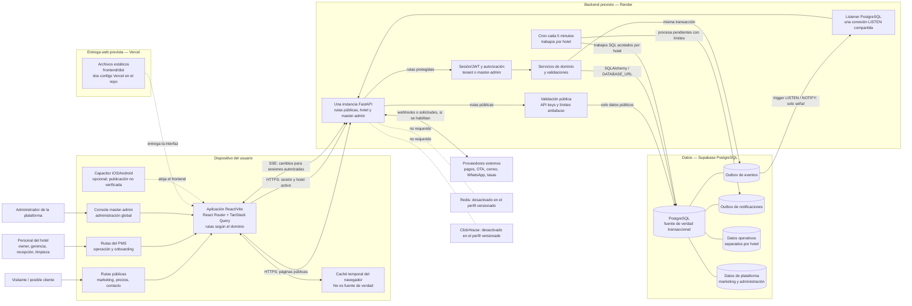
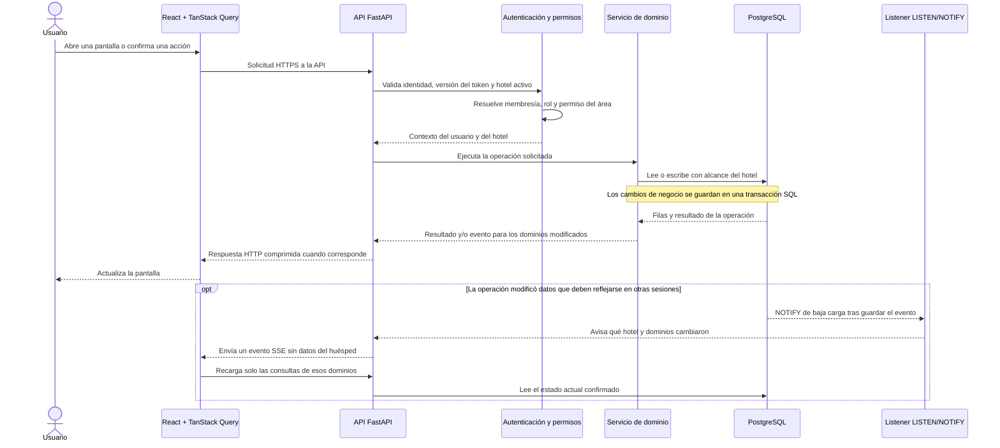
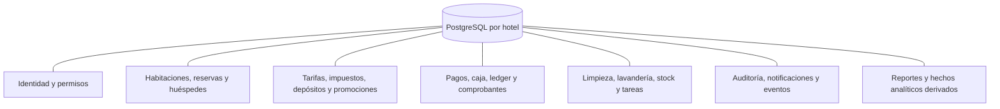
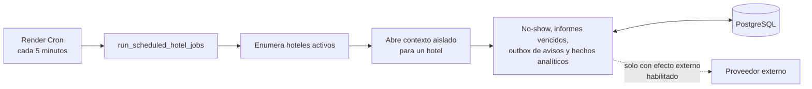

# Mapa de arquitectura actual — Hotel Chipre PMS

Guía visual para que una persona que se incorpora al desarrollo pueda entender dónde corre cada parte, qué sistema es dueño de los datos y cómo una acción llega a los demás usuarios.

> **Alcance de esta guía:** describe el código y la configuración versionada revisados para esta entrega. `render.yaml` es el perfil previsto en el repositorio; no confirma qué variables o servicios están activos en las cuentas de Render, Supabase o Vercel. La última evidencia operativa disponible en el proyecto indicaba que Render respondía `503 suspend-by-user`. Hay que volver a comprobar el estado real antes de hablar de producción.

El repositorio contiene **una aplicación React/Vite** que cambia de rutas según el dominio: el sitio público de `hotels-pms.com` muestra marketing y capta consultas; `app.hotels-pms.com` sirve el PMS del hotel y la consola separada de master-admin. El huésped no tiene aquí una interfaz operativa independiente: el check-in se gestiona desde la aplicación del personal. También hay envoltorios móviles con Capacitor; que estén publicados o en uso no está verificado. Los dos archivos `vercel.json` definen variantes de compilación/ruteo; la asignación actual de dominios en Vercel debe confirmarse en su panel.

## 1. Vista general

Vercel entrega los archivos de React; el dominio decide si se muestra el sitio público, la operación del hotel o el master-admin. El visitante usa sólo las rutas públicas; el personal entra al PMS y el administrador de plataforma usa un flujo de autenticación y permisos separado. Todas esas rutas llaman a FastAPI: ninguna se conecta directamente a PostgreSQL ni a un proveedor con credenciales privadas. La API y el cron leen y escriben en el mismo PostgreSQL. No hay una base NoSQL en el camino transaccional. La caché de TanStack Query vive en el navegador y sirve para reutilizar temporalmente lecturas; PostgreSQL conserva el dato oficial.

## 2. Qué pasa cuando alguien consulta o guarda algo

### Identidad, permisos y separación entre hoteles

- El flujo de la aplicación usa tokens JWT propios y una sesión de servidor opaca para recuperación/rotación. Las solicitudes operativas llevan la identidad a la API; la autenticación de webhooks y de reservas públicas tiene sus propias credenciales o firmas.
- En cada operación se resuelven la cuenta activa, la membresía del hotel elegido y el permiso requerido. Esto permite aplicar cambios de roles o revocaciones sin esperar a que caduque toda la sesión.
- El hotel no se acepta como prueba de acceso por venir en un encabezado: se contrasta con la membresía autenticada. Los servicios filtran por hotel y establecen el contexto de tenant para las políticas de PostgreSQL que correspondan.
- La consola master-admin tiene rutas, autenticación y auditoría propias para administrar la plataforma; no es un rol hotelero ni usa la membresía del hotel como autorización.
- Las páginas públicas de marketing consultan precios publicados y envían leads o consultas a rutas públicas de FastAPI. Esas escrituras no crean datos operativos de un hotel y tienen validación y límites contra abuso.
- Una reserva, pago o movimiento se escribe en PostgreSQL dentro de una transacción. Los bloqueos e idempotencia protegen operaciones que no deben duplicarse o competir.

### Cómo se actualizan las otras pantallas

El navegador no necesita pedir todas las listas cada pocos segundos. Después de una escritura, el backend publica una señal pequeña; React invalida y vuelve a leer solo las categorías afectadas. En la configuración versionada, PostgreSQL `LISTEN/NOTIFY` comparte un listener por proceso y los navegadores reciben eventos SSE. Si ese canal no está disponible, el respaldo consulta el outbox de manera acotada, con una espera de hasta 60 segundos por hotel y proceso. El stream no mantiene abierta la conexión SQL usada para autenticarse.

Los reintentos del cliente también están limitados: los errores 4xx no se repiten, y los errores transitorios tienen como máximo un reintento global. Las consultas que ya están frescas pueden reutilizarse durante 30 segundos; el foco de la ventana no vuelve a lanzar todas las consultas automáticamente.

## 3. De dónde sale y dónde queda cada dato

| Área | Fuente de verdad | Cómo se usa |
| --- | --- | --- |
| Hoteles, usuarios, membresías, roles y permisos | PostgreSQL | Decide qué hotel y qué operaciones puede usar cada persona. |
| Planes publicados, leads, consultas comerciales y registros de plataforma | PostgreSQL | El master-admin administra los datos globales; el sitio público lee precios y envía consultas a endpoints públicos. |
| Huéspedes, restricciones, reservas, habitaciones, bloqueos y tarifas | PostgreSQL | Datos operativos; las listas y fichas se consultan desde la API con alcance por hotel. |
| Pagos, comprobantes, caja, saldos y ajustes del ledger | PostgreSQL | Registros financieros y auditoría de movimientos. No se sustituyen por una caché. |
| Lavandería, stock, tareas y configuración fiscal/de depósitos por hotel | PostgreSQL | Reglas y operaciones de cada establecimiento. El hotel debe definir las políticas requeridas antes de operar. |
| Notificaciones, eventos de dominio y auditoría | PostgreSQL | Outbox durable; `NOTIFY` y SSE solo avisan que hay cambios. El navegador vuelve a leer el dato vigente. |
| Reportes y hechos analíticos | PostgreSQL | Se calculan o leen desde tablas operativas y hechos derivados. El perfil de Render desactiva ClickHouse y la reproducción periódica. |
| Caché de consultas visibles | Memoria de TanStack Query en cada navegador | Reutilización temporal. Se invalida selectivamente; no es persistencia ni fuente de verdad. |
| Fotos, documentos u otros blobs | Depende del backend de almacenamiento configurado | El código admite opciones local/S3/GCS. El manifiesto revisado no prueba cuál está configurada en producción; verificarlo antes de asumir persistencia de archivos. |
| Cotizaciones de moneda | Proveedor externo de tasas, si está habilitado | El perfil versionado deja habilitada la lectura de DolarAPI; confirmar disponibilidad y configuración activas. |
| Pagos externos, emails, OTA, WhatsApp e identidad social | Proveedor correspondiente, con flags y credenciales | El perfil de Render versionado mantiene desactivados los efectos externos y varias conexiones. No asumir que una integración está activa solo porque existe su código. |
| Archivos estáticos de web | Vercel a partir de `frontend/dist` | El bundle contiene rutas públicas y del PMS; el host determina cuáles muestra. La asignación activa de cada dominio debe revisarse en Vercel. |

### Dominios principales guardados en PostgreSQL

Los reportes no son otra fuente de datos independiente: se construyen a partir de PostgreSQL. Las tablas de hechos analíticos son derivadas y pueden reconstruirse a partir de la información operativa según los procesos disponibles. Redis y ClickHouse están contemplados por el código en algunos caminos opcionales, pero no forman parte del perfil económico versionado que se muestra aquí.

## 4. Procesos programados y conexiones externas

El trabajo programado está fuera del inicio de sesión. El cron procesa hoteles dentro de su contexto y no lanza un barrido global por cada usuario que entra. En el perfil versionado hay una API y un cron cada cinco minutos, ambos pequeños; la API limita el pool a cuatro conexiones más dos de margen y el cron usa una conexión. Render cobra el cron por el tiempo que corre, con un mínimo mensual por servicio; el monto real depende de la duración de cada ejecución. Es una configuración de repositorio, no una confirmación de los límites contratados o variables activas del proveedor.

## 5. Perfil de despliegue que declara el repositorio

| Componente | Configuración versionada | Lo que implica |
| --- | --- | --- |
| Frontend | Vercel, React/Vite; sirve `frontend/dist` | El mismo bundle contiene el sitio público y el PMS; React decide las rutas según el hostname. El repositorio tiene configuración Vercel en la raíz y en `frontend/`; verificar en el panel qué proyecto y dominio usa cada una. |
| App móvil | Capacitor iOS/Android en el repositorio | Es un envoltorio del frontend que usa la misma API; la publicación y configuración activa no se comprobaron. |
| API | Render, FastAPI, una instancia `starter`, un worker | El backend no escala horizontalmente con este perfil; la colaboración en memoria requiere una instancia y un worker. |
| Base de datos | PostgreSQL de Supabase mediante `DATABASE_URL` | Autoridad única para datos operativos y financieros. La conexión de peticiones no reemplaza la conexión dedicada a `LISTEN`. |
| Eventos realtime | PostgreSQL `LISTEN/NOTIFY` si se configura `POSTGRES_EVENT_LISTENER_DATABASE_URL` | Debe ser una URL directa o de pooler de sesión. El pooler transaccional del puerto 6543 no conserva `LISTEN`; si se usa, se recurre al respaldo acotado. |
| Cron | Render Cron, cada 5 minutos | Procesa no-shows y tareas por hotel; aún debe comprobarse que exista en la cuenta activa y que haya terminado correctamente. |
| Pool de la API | 4 conexiones + 2 de overflow; espera máxima 5 s | Máximo teórico de seis conexiones SQLAlchemy para esa instancia, sujeto a otros procesos que usen la base. |
| Redis / caché compartida | `REDIS_URL` vacío y caché de lecturas apagada | El diseño no exige Redis para guardar datos ni para el perfil de presupuesto actual. |
| ClickHouse | Deshabilitado | No participa en consultas ni reportes del perfil versionado. |
| Efectos externos | Desactivados en el manifiesto | Para pagos, email y conexiones de proveedores se necesita activar configuración de forma explícita y verificada. |

**Importante para cambios futuros:** no agregar réplicas de API o workers sin revisar la colaboración en memoria, los tickets de un solo uso, los límites de PostgreSQL y el mecanismo compartido de eventos. Escalar réplicas sin cambiar esos límites puede causar comportamiento inconsistente y más conexiones de base.

## 6. Puntos de entrada para una persona desarrolladora

| Si querés entender… | Empezá por… |
| --- | --- |
| Cómo se arma la API y qué rutas monta | `app/main.py` |
| Cómo se conecta el backend con PostgreSQL y configura el pool | `app/database.py`, `app/config.py` |
| Cómo se autentica y obtiene el hotel activo | `app/dependencies/auth.py`, `app/services/tenant_context.py` |
| Cómo se separan marketing, PMS y master-admin por host/ruta | `frontend/src/router.tsx`, `frontend/src/config/publicUrls.ts`, `frontend/src/master_admin/` |
| Cómo el sitio público muestra precios y guarda consultas | `frontend/src/api/marketing.ts`, `frontend/src/api/publicInquiries.ts`, `app/api/public_marketing.py`, `app/api/public_inquiries.py` |
| Cómo se escriben y anuncian cambios | `app/services/domain_events.py`, `app/services/postgres_event_listener.py`, `app/api/events.py` |
| Cómo React reduce lecturas y refresca solo los datos afectados | `frontend/src/main.tsx`, `frontend/src/api/queryInvalidation.ts`, `frontend/src/sync/crossTabSync.ts` |
| Cómo corren avisos y no-shows programados | `app/tasks/run_scheduled_hotel_jobs.py`, `app/services/scheduled_hotel_jobs_service.py`, `render.yaml` |
| Cómo se prueba rendimiento con PostgreSQL | `tests/perf/benchmark_pg.py`, `tests/perf/benchmark_allocation_solver.py` |
| Qué mediciones y límites se observaron localmente | `docs/audits/reporte-final-remediacion-consumo-y-simulaciones-2026-10-12.md` |

## 7. Qué falta verificar en la nube

Este diagrama no certifica que la aplicación esté funcionando en producción. Antes de habilitar tráfico, revisar en los paneles de los proveedores:

1. Estado, SHA servido y fecha de la API en Render; verificar `/health` y `/build-meta.json`.
2. Estado y plan/costo de la API y del cron en Render; el cron debe existir y tener una ejecución exitosa.
3. Que `DATABASE_URL` y `POSTGRES_EVENT_LISTENER_DATABASE_URL` apunten al proyecto esperado. Para `LISTEN`, usar conexión directa o de sesión y comprobar que el listener queda conectado.
4. Valores activos de `READ_MODEL_CACHE_ENABLED`, `REDIS_URL`, `CLICKHOUSE_ENABLED`, `EXTERNAL_EFFECTS_ENABLED` y de cada integración; el YAML del repositorio no prueba los valores cargados en Render.
5. Dominio, URL de API, reglas de CORS y SHA de frontend en Vercel.
6. Métricas reales de solicitudes/egreso de Render, transferencias de PostgreSQL/Supabase, consultas por ruta, espera del pool y bytes de respuesta.

Las mediciones sintéticas locales explican qué trabajo ejecuta el código bajo escenarios controlados; no reconstruyen el consumo histórico real de Render ni de Supabase. La instrumentación de la API permite reunir evidencia por ruta en una ejecución posterior, pero la causa histórica solo puede asignarse si hay métricas o registros conservados de ese período.
